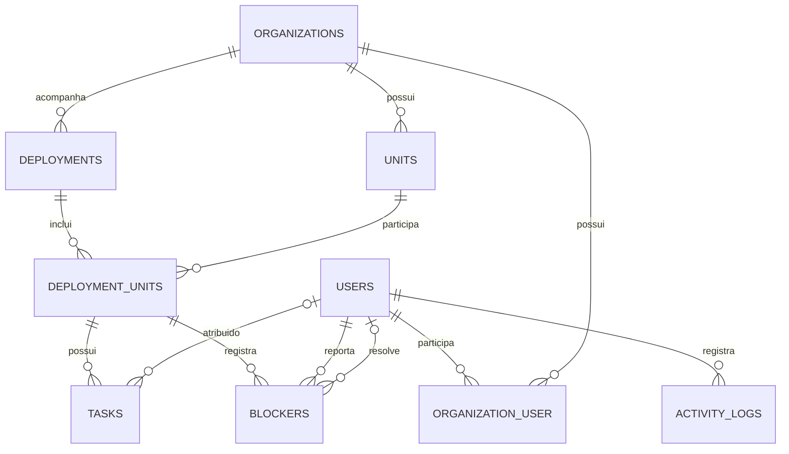

# Rota ERP

Plataforma web demonstrativa para planejar e acompanhar implantações de sistemas ERP em múltiplas unidades. O projeto reúne etapas, tarefas, responsáveis, prazos e impedimentos em um só lugar.

> Projeto independente para estudo e portfólio. Todas as organizações, unidades e informações usadas nas demonstrações serão fictícias.

## Objetivo do MVP

Permitir que uma pessoa gestora acompanhe uma implantação, compare o progresso das unidades e identifique tarefas atrasadas ou impedimentos. Integrantes das unidades poderão atualizar suas tarefas e registrar problemas que precisam de atenção.

## Modelo de dados (MVP)

O diagrama apresenta as relações principais do modelo inicial. Os nomes das tabelas estão em inglês; os papéis exibidos na aplicação serão **Gerente**, **Supervisor** e **Técnico**.



### Regras principais

- `organization_user` liga usuários às organizações e guarda o papel de cada pessoa (`manager`, `supervisor` ou `technician`), exibido na aplicação como Gerente, Supervisor ou Técnico.
- `deployment_units` liga uma implantação às unidades participantes e guarda o andamento e as datas previstas e reais de cada unidade.
- Tarefas e impedimentos pertencem a uma participação específica em `deployment_units`. O responsável e o prazo da tarefa podem ser definidos depois.
- Um impedimento aberto pode coexistir com a unidade em andamento, pois o problema pode afetar apenas parte do trabalho.
- `activity_logs` registra quem fez a alteração, o item afetado, os valores anterior e novo e quando ocorreu. `subject_type` e `subject_id` identificam o tipo e o registro alterado.

## Tecnologias

- **Back-end:** PHP 8.3+ e Laravel 13
- **Interface:** Blade, HTML e CSS; JavaScript quando necessário
- **Banco de dados:** PostgreSQL
- **Versionamento e colaboração:** Git e GitHub
- **Etapas futuras:** testes automatizados, GitHub Actions, Docker e hospedagem

## Estado atual

- Aplicação Laravel 13 criada na pasta `app/`, usando Blade.
- Banco PostgreSQL local configurado e migrations iniciais executadas.
- Aplicação iniciando localmente com `composer run dev`.
- Repositório Git configurado com remoto no GitHub.

O projeto está sendo desenvolvido como uma trilha prática. Cada etapa será explicada e aplicada em uma entrega pequena, para que os conceitos de Laravel, SQL, Git e hospedagem sejam aprendidos durante a construção.

## Executar localmente

### Pré-requisitos

- PHP 8.3 ou superior
- Composer
- Node.js e npm
- PostgreSQL

### Configuração

O arquivo [`.env.example`](.env.example) contém valores de exemplo, sem senhas reais. Na primeira configuração, copie-o para a pasta da aplicação e gere a chave local do Laravel:

```powershell
Copy-Item .env.example app/.env
Set-Location app
php artisan key:generate
```

Configure os dados do PostgreSQL em `app/.env`. A senha deve ficar somente nesse arquivo local; não a publique no GitHub.

Para criar as tabelas do banco e iniciar a aplicação:

```powershell
php artisan migrate
composer run dev
```

Com o servidor em execução, acesse `http://127.0.0.1:8000` no navegador.

## Privacidade e segurança

Use apenas dados fictícios nas demonstrações. Credenciais e configurações específicas do computador ficam em `app/.env`, que não deve ser enviado ao GitHub. O arquivo `.env.example` serve como modelo e não deve conter senhas reais.

## Próximas etapas

1. Revisar e concluir o modelo de dados documentado no README.
2. Criar as migrations e os models do esquema inicial.
3. Preparar dados fictícios para demonstração.
4. Implementar os primeiros cadastros em pequenas entregas versionadas.
